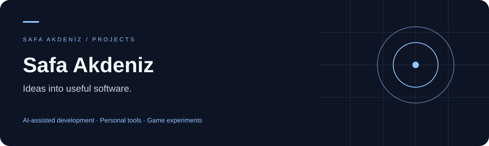

# Merhaba, ben Safa 👋

Yapay zekâ desteğiyle günlük hayatta kullanabileceğim araçlar ve küçük oyun deneyleri geliştiriyorum. Fikirleri küçük adımlarla uygulamaya dönüştürmek, arayüzü iyileştirmek ve sonucu gerçek kullanımda kontrol etmek ilgimi çekiyor.

### Neler üzerinde çalışıyorum?

| Alan | İlgi odağım |
| --- | --- |
| 🧠 Kişisel araçlar | Bilgi keşfi, öğrenme ve verimlilik |
| 🎙️ Asistan deneyimleri | Ses, bellek ve masaüstü etkileşimi |
| 🎮 Oyun geliştirme | Unity ve Godot ile küçük prototipler |
| 🛠️ Geliştirme akışları | AI desteği, küçük görevler ve test kanıtları |

### Projelerimde kullandığım teknolojiler

`Python` · `JavaScript / TypeScript` · `React` · `HTML / CSS`  
`FastAPI` · `Tauri` · `Unity / C#` · `Godot / GDScript`

### Nasıl çalışıyorum?

Fikir → küçük prototip → kullanım kontrolü → iyileştirme.

Sade arayüzlere, anlaşılır dokümantasyona ve ölçülebilir ilerlemeye önem veriyorum. Çalışmalarımın çoğu şu an özel depolarda gelişiyor; paylaşılabilir projeler hazır oldukça burada yer alacak.

---

**AI ile üretmek, deneyerek öğrenmek.**
